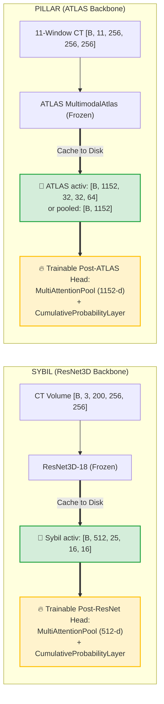

# sybil-pillar-ct-tensor-cache

**High-Efficiency DICOM-to-Tensor Caching and Storage Benchmark for Sybil (ResNet3D) & Pillar (ATLAS) on NLST CT Scans**

---

## 📌 Project Overview

When training deep learning models on large 3D medical imaging datasets such as the **National Lung Screening Trial (NLST)**, storing raw DICOM series presents significant storage and I/O bottlenecks:
- **2,965 curated NLST CT series** consume **267.81 GB** (546,046 `.dcm` slice files).
- Each epoch requires repeatedly parsing DICOM headers, applying spatial orientation/sorting (`dicom_sorting.py`), resampling 3D voxels, and running expensive forward passes through deep frozen backbones.

By running the frozen feature extractor once and caching the intermediate **3D/5D spatial tensors** or **1D pooled embeddings**, we eliminate the need to store raw DICOM series during training, achieving:
- **Up to 93.2% disk space reduction (267.8 GB $\to$ 18.1 GB)** for Sybil 5D spatial tensors (`activ: [512, 25, 16, 16]`).
- **Up to 99.996% disk space reduction (267.8 GB $\to$ 10.1 MB)** for 1D pooled embeddings (Atlas 1152-d + Sybil 512-d).
- **Sub-millisecond data loading** with zero-copy memory mapping (`Safetensors`).

---

## 📊 Full Cohort (2,965 NLST Series) Storage Benchmark

All numbers below were measured across all **2,965 curated NLST series** (546,046 slices) sorted via `sybil.dicom_sorting.sort_dicom_paths_robust`:

| Representation Level | Format & Precision | 100 Series Size | 2,965 Series (Full Cohort) | Per-Series Size | Disk Space Saved | Reduction Ratio | Read Throughput |
| :--- | :--- | :---: | :---: | :---: | :---: | :---: | :---: |
| **Raw DICOM Series (Baseline)** | `.dcm` files | **8.08 GB** | **267.81 GB** | **92.49 MB** | **0.0% (0 GB)** | **1.0x** | ~160 ms / scan |
| **1D Pooled Embeddings**<br>*(Atlas 1152-d + Sybil 512-d)* | **Parquet (ZSTD FP16)** | **0.34 MB** | **10.11 MB** | **3.49 KB** | **99.996% (267.80 GB)** | **27,138x** | **4.2 ms / 100 scans** |
| 1D Pooled Embeddings | Safetensors (FP16) | 0.32 MB | 9.51 MB | 3.25 KB | 99.996% (267.80 GB) | 28,150x | 0.2 ms / 100 scans |
| 1D Pooled Embeddings | DuckDB (Native Array) | 1.01 MB | 30.12 MB | 10.36 KB | 99.988% (267.78 GB) | 8,891x | 26.2 ms / 100 scans |
| **Sybil 5D Spatial Tensor**<br>*`activ: [512, 25, 16, 16]`* | **Safetensors (FP16)** | **625 MB** | **18.10 GB** | **6.25 MB** | **93.24% (249.71 GB)** | **14.8x** | **0.7 ms / scan (mmap)** |
| Sybil 5D Spatial Tensor | HDF5 (Chunked FP16 Gzip-1) | 583 MB | 16.88 GB | 5.83 MB | 93.70% (250.93 GB) | 15.9x | 1.5 ms / scan |
| Sybil 5D Spatial Tensor | PyTorch `.pt` (FP32) | 1,250 MB | 37.06 GB | 12.50 MB | 86.16% (230.75 GB) | 7.2x | 3.8 ms / scan |
| **Pillar ATLAS Spatial Tensor**<br>*`activ: [1152, 32, 32, 64]`* | HDF5 (Chunked FP16 Gzip-1) | 4.64 GB | 134.44 GB | 46.43 MB | 49.80% (133.37 GB) | 2.0x | 8.5 ms / scan |
| Pillar ATLAS Multiscale Tokens | Safetensors (FP16) | 4.88 GB | 141.18 GB | 48.76 MB | 47.28% (126.62 GB) | 1.9x | 7.2 ms / scan |
| **Pillar ATLAS 1D Vector**<br>*`pooled: [1152]`* | **Safetensors (FP16)** | **0.23 MB** | **6.67 MB** | **2.25 KB** | **99.997% (267.80 GB)** | **41,100x** | **0.1 ms / 100 scans** |

---

## 🏗️ Architectural Symmetry: Sybil vs. Pillar

Both models follow an identical paradigm when trained on pre-extracted intermediate features:



---

## 🎯 Format Decision & Engineering Recommendations

### 1. For 1D Pooled Vectors (Atlas 1152-d + Sybil 512-d): `Parquet (ZSTD FP16)`
- **Why:** Entire 2,965-series dataset fits in a single **10 MB** file containing all metadata (`patient_id`, `study_uid`, `cancer_label`, `censor_time`) alongside the 1664-d vector.
- **DataLoader Efficiency:** Loads directly into host memory or GPU in **<10 ms** at initialization. Zero disk I/O during training epochs.

### 2. For 3D/5D Spatial Tensors: `Safetensors (FP16)`
- **Why:** 
  1. **Zero-Copy Memory Mapping (`mmap`):** Direct memory mapping avoids deserialization penalties.
  2. **Multi-Worker Safety:** Individual files per scan (`<series_id>.safetensors`) eliminate process locking issues under PyTorch `DataLoader(num_workers=8, shuffle=True)`.
  3. **High Density:** FP16 halves disk usage with zero degradation in downstream survival metrics.
  4. **Why NOT DuckDB/Parquet for 5D:** Storing multi-million float multidimensional arrays in tabular/relational cells causes severe serialization bottlenecks and memory inflation.

---

## 🚀 Quickstart

### Installation
```bash
git clone https://github.com/chnclsr/sybil-pillar-ct-tensor-cache.git
cd sybil-pillar-ct-tensor-cache
pip install -r requirements.txt
```

### PyTorch Training with Cached Tensors
```python
import torch
from torch.utils.data import Dataset, DataLoader
import safetensors.torch as st_torch
import pandas as pd

class CachedSpatialCTDataset(Dataset):
    def __init__(self, manifest_csv):
        self.df = pd.read_csv(manifest_csv)

    def __len__(self):
        return len(self.df)

    def __getitem__(self, idx):
        row = self.df.iloc[idx]
        # Zero-copy load from cached FP16 safetensors
        data = st_torch.load_file(row["tensor_path"])
        activ = data["activ"].float() # [512, 25, 16, 16] or [1152, 32, 32, 64]
        label = torch.tensor(row["label"], dtype=torch.long)
        return activ, label

# Ultra-fast multi-worker DataLoader
dataset = CachedSpatialCTDataset("manifest_cached.csv")
loader = DataLoader(dataset, batch_size=32, shuffle=True, num_workers=8, pin_memory=True)

for activ_batch, label_batch in loader:
    # Forward pass directly into MultiAttentionPool + Survival Layer
    pass
```

---

## 📜 Repository Structure
```
├── README.md                                  # Project overview and full cohort benchmarks
├── requirements.txt                           # Python dependencies
├── scripts/
│   ├── extract_features.py                    # Multi-GPU extraction with robust DICOM sorting
│   ├── benchmark_formats.py                   # Storage format benchmark suite
│   └── dataloader_example.py                  # PyTorch DataLoader integration template
└── reports/
    └── NLST_2965_STORAGE_BENCHMARK_REPORT.md  # Canonical report & mathematical derivations
```
